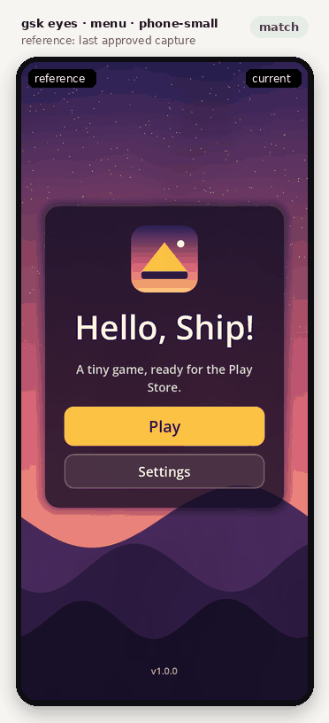
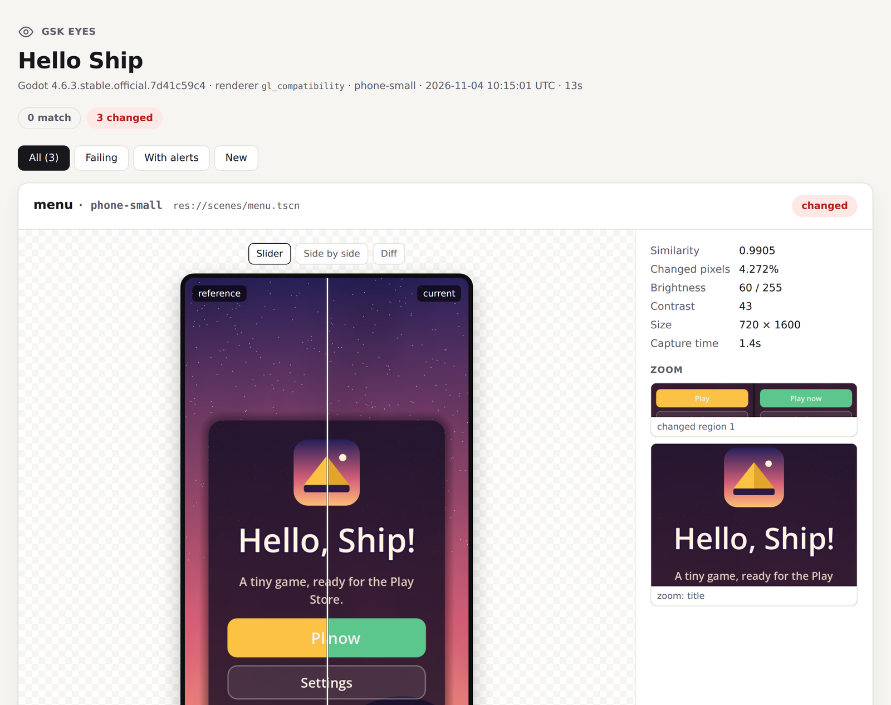
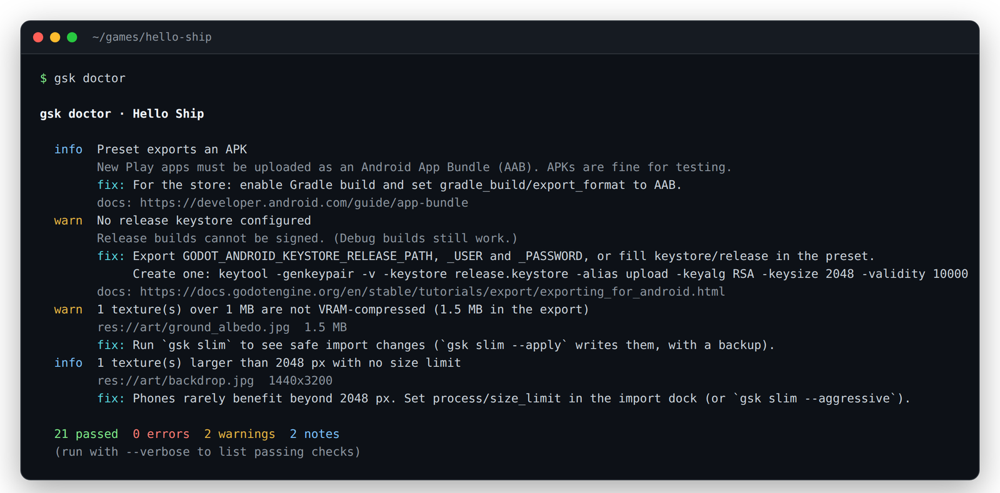
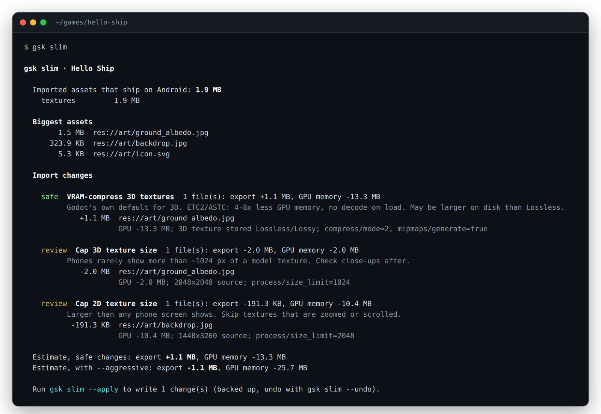

<h1 align="center">godot-ship-kit</h1>

<p align="center">
  <b>From Godot repo to a Play-ready Android build, with eyes for your coding agent.</b><br>
  One CLI (<code>gsk</code>) and one agent skill: check the export setup, shrink the APK, build and verify it,<br>
  and render your scenes at phone resolutions on a server with no GPU so the agent can see what it changed.
</p>

<p align="center">
  <a href="https://github.com/vladosskins178/godot-ship-kit/actions/workflows/ci.yml"></a>
  <a href="LICENSE"></a>
  
  
  
</p>

<p align="center">
  
</p>

---

AI agents can write GDScript all day. Then the game has to reach a phone, and that is
where it breaks: Android SDK and JDK paths, export templates, keystores, an AAB instead
of an APK, a target API level Google raised again, a 600 MB build, and a UI that looks
fine in the editor but is cut off on a 20:9 screen. The agent can't see any of it.

`gsk` turns those into commands with clear answers:

| Command | What it does |
| --- | --- |
| `gsk doctor` | Checks the project, export preset, Android SDK / JDK / templates, signing, Play's target API level, renderer choice, textures and size. Every finding comes with a fix. |
| `gsk slim` | Shows what actually ships (Godot's imported files, not your sources), proposes `.import` changes, applies them with a backup, re-imports and reports the new size. |
| `gsk build` | Headless APK/AAB export with signing from environment variables, then verification: zip integrity, signature, 16 KB alignment, target SDK, permissions, size breakdown. |
| `gsk eyes` | Renders scenes at phone resolutions with software OpenGL, compares them with reference images, flags black frames, missing materials and idle rigs, and writes an HTML report plus a Markdown one for agents. |
| `gsk play-checklist` | A Play Console launch checklist filled in from your project, with links to the official pages. |

It grew out of shipping a real Godot 4 game to Android, where fixing texture import
settings took the APK from **651 MB to 273 MB**, and where the most useful habit turned
out to be making the agent render and look at a change before calling it done.

## Quick start

```bash
pipx install "godot-ship-kit[eyes] @ git+https://github.com/vladosskins178/godot-ship-kit"
export GODOT=/path/to/godot              # if godot is not on PATH

cd my-game
gsk doctor                               # what blocks an Android release?
gsk slim                                 # what makes the build big?
gsk eyes --scene res://ui/menu.tscn      # what does it look like on a phone?
gsk build                                # export and verify (release by default)
```

Try it on the sample project in this repo:

```bash
git clone https://github.com/vladosskins178/godot-ship-kit && cd godot-ship-kit
pip install -e ".[eyes]"
$GODOT --headless --path examples/hello-ship --import
gsk eyes examples/hello-ship             # 3 shots, all match the committed references
```

`doctor`, `slim`, `build` and `play-checklist` need only the Python standard library.
`gsk eyes` adds Pillow and numpy (the `[eyes]` extra) and, on a headless Linux box,
`xvfb`, Mesa and the X11 client libraries Godot loads:

```bash
sudo apt install xvfb libgl1-mesa-dri libx11-6 libxcursor1 libxinerama1 libxrandr2 libxi6 libxkbcommon0
```

## gsk eyes: let the agent see

```bash
gsk eyes                                         # shots from gsk.toml, or the main scene
gsk eyes --scene res://scenes/shop.tscn --device phone --device tablet
gsk eyes --update                                # save the current captures as references
```

`gsk eyes` starts Godot under a virtual display, loads each scene at a real phone
resolution, waits, optionally presses buttons or calls methods, and saves a screenshot.
It uses the renderer your game uses **on the phone** (`rendering_method.mobile`), so a
project that runs Forward+ on desktop is checked the way Android will draw it.

Each capture is then compared with its reference:

- **Similarity** (SSIM over a downscaled copy, so it judges structure, not dithering) and
  **changed pixels** (per-pixel difference above a tolerance). A shot matches when both
  are within the thresholds.
- **Changed regions** are boxed in a diff image, listed as frame fractions, and saved as
  full-resolution *reference | current* crops.
- **Alerts** catch the classic silent failures: a black frame, a flat frame, a mesh with
  no material (renders plain white), a 3D scene without a current camera, nothing in
  view, a rigged model whose animations are not playing (T-pose), and engine or script
  errors raised while the scene ran.

<p align="center"></p>

The HTML report has a reference/current slider, a side-by-side view and a diff view.
Next to it, `report.md` and `report.json` give an agent the same facts as text, with
paths to the **zoom crops**. That matters more than it sounds: when an agent opens a
1080x2400 screenshot, it gets downscaled until small text is unreadable. Crops at full
resolution are how it notices a clipped label or a price that runs out of its box.

Configure shots in `gsk.toml` at the project root:

```toml
[eyes]
devices = ["phone", "phone-small"]   # or "tablet", "phone-landscape", "1440x3200", ...
references = "tests/eyes"            # committed; gsk adds a .gdignore so they never ship
threshold = 0.985                    # minimum similarity
max_changed = 0.003                  # at most 0.3% of pixels may change

[[eyes.shot]]
name = "menu"
scene = "res://scenes/menu.tscn"
wait = 1.0
zoom = [{ name = "title", rect = [0.1, 0.25, 0.8, 0.25] }]

[[eyes.shot]]
name = "shop-open"
scene = "res://scenes/menu.tscn"
actions = [{ tap = [0.5, 0.62] }, { wait = 0.5 }, { node = "Shop", call = "select_tab", args = [2] }]
```

Full reference: [docs/eyes.md](docs/eyes.md).

Software rendering is deterministic, which is what makes reference images work: the
sample project renders identical captures run after run. It shows layout, colour,
composition and missing assets. It does not show real-device performance.

## gsk doctor

<p align="center"></p>

Forty checks, grouped as:

- **Toolchain**: Godot binary and version match, export templates for that exact version,
  Android SDK (platform-tools, build-tools, cmdline-tools, platform), JDK 17, Gradle
  build template version.
- **Preset**: package name (no `com.example`), version code, `arm64-v8a`, APK or AAB,
  target and min SDK (read from the build template you actually use), sensitive
  permissions, INTERNET when ads, analytics or HTTP are used, launcher icons.
- **Signing**: release keystore from environment variables or the preset, password and
  alias present (never printed), keystore or `export_credentials.cfg` committed to git,
  `.godot/` in git.
- **Rendering**: ETC2/ASTC import, mobile renderer choice for low-end Mali and Adreno,
  OpenGL fallback, MSAA, Forward+-only environment effects the phone will ignore,
  stretch mode, orientation.
- **Assets and size**: uncompressed textures, oversized textures, normal maps, big WAVs,
  total imported size against Play's limits.

The Play numbers (API 36 since 31 Aug 2026, 16 KB page size, 500 MB base module, 200 MB
mobile-data warning) live in one file, [`playreq.py`](src/godot_ship_kit/playreq.py), each
with its source and the date it was checked. Full list: [docs/checks.md](docs/checks.md).

## gsk slim

<p align="center"></p>

The size of your PNG does not matter. What ships is the copy Godot makes in
`.godot/imported`, and its size comes from the `.import` settings: a 600 KB JPEG imported
*Lossless* at 2048 px can cost several MB in the APK and 16 MB of GPU memory on the phone.

`gsk slim` measures every imported file, maps it back to its source, and proposes changes:

- **safe**: VRAM compression (ETC2/ASTC) for textures used in 3D, which is what Godot does
  itself when it detects 3D use, plus normal-map compression. Big GPU memory savings;
  the export can get smaller or larger, and the report says which.
- **review** (`--aggressive`): size caps for 3D and 2D textures, Lossy WebP for big 2D art,
  QOA for long WAVs. These trade quality for size, so look at the result with `gsk eyes`.

It also lists **possibly unused** assets (no `res://` reference found, counting paths built
with `%s` or string concatenation) and **heavy models** (triangle counts read straight from
GLB files). `--apply` backs up every `.import` it touches, `--undo` restores them, and
`--reimport` runs Godot and prints the measured result.

## gsk build

```bash
export GODOT_ANDROID_KEYSTORE_RELEASE_PATH=/secure/upload.keystore
export GODOT_ANDROID_KEYSTORE_RELEASE_USER=upload
export GODOT_ANDROID_KEYSTORE_RELEASE_PASSWORD=...      # from your CI secret store
gsk build                       # release, path from the preset, verified
gsk build --debug -o build/test.apk
gsk verify build/game.aab       # verify an APK/AAB you already have
```

Godot's exit code is not a reliable signal after a failed export, so `gsk build` treats a
missing or stale output file as a failure, keeps the full log in `.gsk/logs/`, and matches the log
against known export errors to print a `hint:`. Verification runs `apksigner`,
`zipalign -c -P 16` (16 KB page alignment), `aapt2 dump badging` or `bundletool`, and
breaks the archive down into native libraries, imported assets, dex and resources, with
the largest entries traced back to their source files.

## gsk play-checklist

`gsk play-checklist -o PLAY_CHECKLIST.md` writes a Markdown checklist for the Play Console:
build requirements, store listing text limits and graphic specs, Data safety (pre-filled
with the ad, analytics and billing SDKs it finds in `addons/` and the preset), content
rating, target audience, app access, and the 12-testers-for-14-days rule for new personal
accounts. It is guidance with links to Google's pages, not policy advice.

## Use it from an agent

**Claude Code** (plugin with the skill):

```text
/plugin marketplace add vladosskins178/godot-ship-kit
/plugin install godot-ship-kit@godot-ship-kit
```

Or copy only the skill: `gsk skill install` writes `~/.claude/skills/godot-ship-kit/SKILL.md`.

**Codex, Cursor, Gemini CLI, Aider and others**: append the instructions to your game's
`AGENTS.md` (or rules file):

```bash
gsk skill print >> AGENTS.md
```

The skill teaches the loop (doctor, slim, build, eyes, checklist), when to use `--json`,
to read the zoom crops before judging text, never to save a regression as a reference,
and to keep signing secrets in environment variables.

## CI

[`.github/workflows/ci.yml`](.github/workflows/ci.yml) downloads Godot, imports the sample
project, runs `doctor`, `slim`, `play-checklist` and `eyes` against the committed
references, and uploads the eyes report as an artifact. [docs/ci.md](docs/ci.md) has a
workflow for your own game that builds a signed AAB from repository secrets.

## Requirements and limits

- Python 3.11+ and Godot 4.x (developed and tested with 4.6.3). Linux is the main
  target; `doctor`, `slim`, `build` and `verify` also run on macOS and Windows, where
  `eyes` uses the native display.
- `gsk eyes` captures what the scene renders under Mesa's llvmpipe. GPU-specific bugs
  and frame rate still need a real phone.
- Scenes that animate over time need a fixed `wait` and a looser per-shot `threshold`,
  or a paused state.
- `slim` estimates assume ETC2. Use `--reimport` for measured numbers.

## Contributing

Issues and pull requests are welcome; see [CONTRIBUTING.md](CONTRIBUTING.md). Each doctor
check needs a test, a fix text a person can act on and, where one exists, a link to
official docs.

## License

[MIT](LICENSE)
